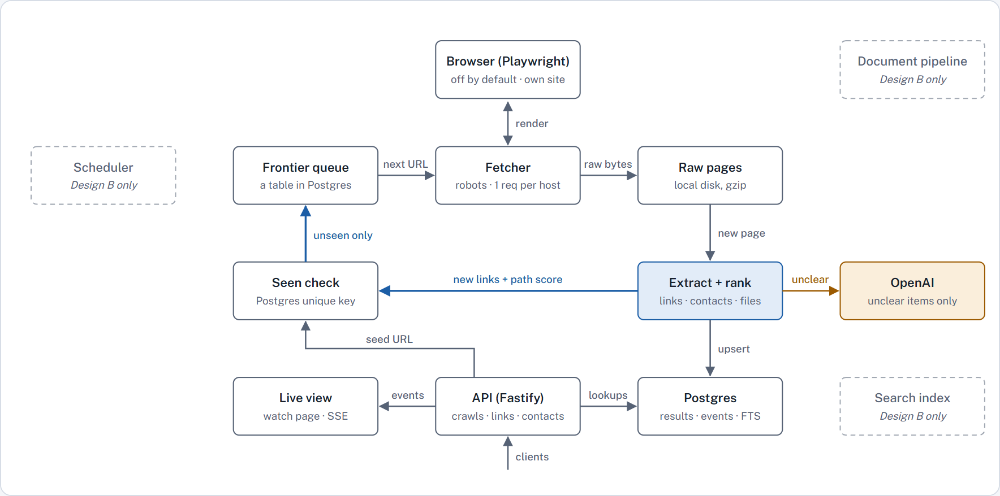
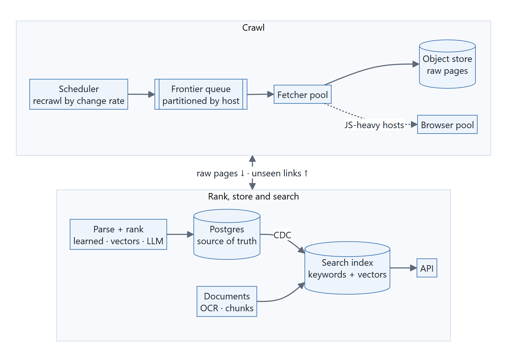
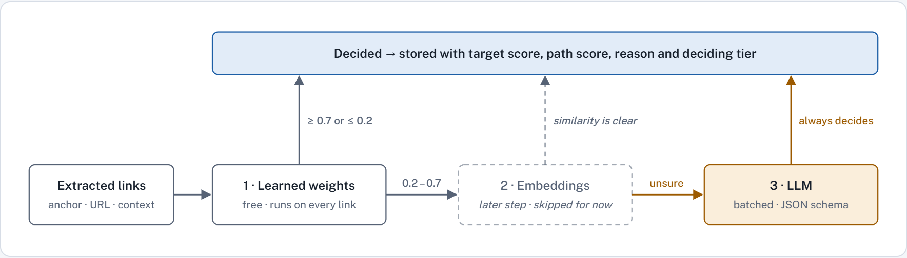

<div align="center">

# FiscalScout

**Finds the budget, the annual financial report and the finance director on a public-sector website.**<br>
Ranks every link with learned weights, and serves the results through a REST API with a live view.

[Live demo](https://scraper.igal-web.com) · [Architecture](https://scraper.igal-web.com/architecture) · [How it works](docs/how-it-works.md) · [API](docs/api.md)


</div>


## System design

### Design A · built

One Node process and one Postgres. The crawl queue, the results and the live events all live in
the same database, so the whole system starts with `docker compose up`.



### Design B · at millions of pages a day

Not built. The same stages, split into pools that scale on their own and talk through queues.



| | Design A · built | Design B · at scale |
|---|---|---|
| **Queue** | Postgres table, `SKIP LOCKED` | Kafka or SQS, partitioned by host |
| **Seen set** | Unique key on the URL hash | Bloom filter in Redis, Postgres as the final word |
| **Raw pages** | Gzip files on local disk | Object store, keyed by content hash |
| **Ranking** | Learned weights, LLM when unsure | Adds embeddings and a learned path score |
| **Documents** | Ranked by their link | Full text, OCR, searchable chunks |
| **Freshness** | Crawl on request | Recrawl by change rate and the fiscal calendar |

[Design B in numbers →](docs/scaling.md) · [Both designs in full →](https://scraper.igal-web.com/architecture)

## The logic of links

Every link gets **two scores**. The **target score** says whether the link is the document
itself: the budget, the ACFR, the finance director's page. The **path score** says whether it
leads to one. The crawl follows the path score; the results sort by the target score.



A real result from Ann Arbor, with the reasons the API returns:

```text
Adopted Budget FY2026   (PDF, under "Annual Budgets")              target score 0.93
  names fiscal year 2026                       +2.4
  'budget' in the link text                    +1.8
  the link text is just the name and year      +1.1
  found on a page with path score 0.80         +0.6
  'budget' in the URL or file name             -0.6
```

- **The signals:** where the keyword sits, whether the link text is just a name and a year, and
  whether the link is a file, a list page, a paper about the document or another government's
  report.
- **The weights are learned:** fitted on 5,402 links from 22 public bodies that an LLM labeled,
  for $0.43. The hand-set rules are one switch away.
- **The LLM only when unsure:** it sees short link records, never whole pages, and the system
  runs without a key.
- **Contacts are results too:** name, title, email and phone, each checked against the page text.

### How the weights were learned

The first weights were set by hand: guesses, checked on four sites. These are fitted on labeled
links instead.

| 1 · Collect | 2 · Label | 3 · Train | 4 · Test |
|---|---|---|---|
| 22 public bodies crawled: cities, counties, school districts and universities. **5,402 links** that carry a keyword. | `gpt-4.1-mini` marks each link: the document itself, or not. **$0.43** for all of them, and 58 of 60 right in a hand check. | Logistic regression over the 22 signals, solved with Newton's method in about 100 lines. Every site counts the same. | Each site is scored by a model that never saw it, and compared with the hand-set weights. |

| Each site held out | Hand-set weights | Learned weights |
|---|:---:|:---:|
| AUC over all labeled links | 0.762 | **0.833** |
| Labeled targets in each site's top 10 | 118 / 170 | **132 / 170** |
| Sites better · worse · the same | | 9 · 2 · 7 |

<details>
<summary><b>What the model learned</b></summary>
<br>

| Pushes a link up | | Pushes a link down | |
|---|:---:|---|:---:|
| The link text is only a year, under a heading that names the document | +4.4 | A paper about the document: answers, a presentation, a notice | −3.9 |
| A full official name in the link text | +3.0 | A file matched by a contact title | −2.5 |
| A fiscal year is named | +2.4 | Another government's site | −2.3 |
| The keyword is in the link text | +1.8 | A page on the entity's site named for a document: usually the list | −2.3 |
| The link text is just the name and the year | +1.1 | Other words in the link text besides the name and year | −1.6 |

One surprise: a keyword only in the URL counts slightly against (−0.6). Language switchers and
menu pages carry "budget" in their URLs too.

</details>

[The method, the data and every weight →](docs/how-it-works.md#learned-weights-the-default-ranker)

## Results

The four test sites from the brief, each crawled once with the default settings and ranked three
ways: hand-set rules, rules with an LLM, and the learned weights.

| Site | Must-find | Top-10 precision<br><sub>rules · LLM · learned</sub> |
|---|:---:|:---:|
| Ann Arbor | 3 / 3 | 10 · 10 · 10 |
| Boerne ISD | 3 / 3 | 10 · 10 · 10 |
| Arizona State | 3 / 3 | **7** · 10 · **10** |
| Bozeman | 2 / 3 | 9 · 9 · 9 |

The learned weights match the LLM without calling it: at ASU they lift the top 10 from 7 to 10,
with a model that never saw the test sites.

Bozeman's miss is its finance director, listed last name first in a directory table.
[All the results →](docs/how-it-works.md#results-on-the-test-sites)

## Quick start

```bash
git clone https://github.com/igalk1515/FiscalScout.git && cd FiscalScout
docker compose up --build
```

Open **http://localhost:3000**, pick a test site and press **Crawl**. An OpenAI key is optional.
[Setup and commands →](docs/setup.md)

## API

```bash
curl -X POST localhost:3000/v1/crawls -H 'content-type: application/json' -d '{"url": "https://www.a2gov.org/"}'
curl 'localhost:3000/v1/links?host=a2gov.org&type=document&min_score=0.7'
curl 'localhost:3000/v1/contacts?host=a2gov.org'
```

Interactive docs at `/docs`. [Every endpoint, with real responses →](docs/api.md)

<details>
<summary><b>The live view of a crawl</b></summary>
<br>

</details>

## Read more

| Read | What is inside |
|---|---|
| [How it works](docs/how-it-works.md) | Results, ranking, learned weights, contacts, crawling, data model, tests, limits |
| [API](docs/api.md) | Every endpoint, with examples and real responses |
| [Setup](docs/setup.md) | Docker, local development, commands, settings |
| [At scale](docs/scaling.md) | Running it at millions of pages a day |
| [Architecture](https://scraper.igal-web.com/architecture) | The design and its decisions ([source](docs/design.html)) |
| [Build log](docs/build-log.md) | How each step was checked, and what the real sites taught |
