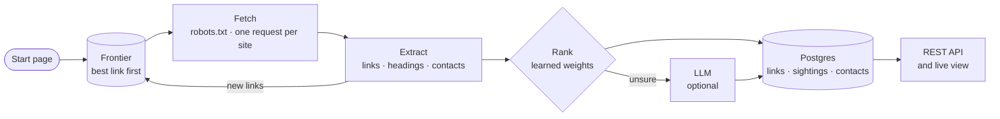

<div align="center">

# FiscalScout

**Finds the budget, the annual financial report and the finance director on a public-sector website.**<br>
Ranks every link with learned weights, and serves the results through a REST API with a live view.

[Live demo](https://scraper.igal-web.com) · [Architecture](https://scraper.igal-web.com/architecture) · [How it works](docs/how-it-works.md) · [API](docs/api.md)


</div>


## What it does

| | |
|---|---|
| **Ranks every link** | Weights learned from 5,402 labeled links on 22 public bodies. Every score shows its reasons. |
| **Returns results, not just links** | Documents with their type and fiscal year. Contacts with name, title, email and phone, each checked against the page. |
| **Crawls with focus** | The most promising link first, robots.txt, one request at a time per site, so a 300-page budget is spent on the finance pages. |
| **Shows its work** | A REST API with OpenAPI docs, and a live view of every crawl. |

## Results

The four test sites from the brief, each crawled once with the default settings and ranked three
ways: hand-set rules, rules with an LLM, and the learned weights.

| Site | Must-find | Top-10 precision<br><sub>rules · LLM · learned</sub> |
|---|:---:|:---:|
| Ann Arbor | 3 / 3 | 10 · 10 · 10 |
| Boerne ISD | 3 / 3 | 10 · 10 · 10 |
| Arizona State | 3 / 3 | **7** · 10 · **10** |
| Bozeman | 2 / 3 | 9 · 9 · 9 |

The learned weights match the LLM without calling it. Across 22 sites, each scored by a model
that never saw it:

> **AUC 0.83** against 0.76 for the hand-set weights · **132 of 170** labeled targets in the top 10, against 118

Bozeman's miss is its finance director, listed last name first in a directory table.
[All the results →](docs/how-it-works.md#results-on-the-test-sites)

## How it works



- **Two scores per link.** The *target score* says whether the link is the document itself; the
  *path score* says whether it leads to one. The crawl follows paths, the results sort by target.
- **Learned weights.** Logistic regression over 22 signals, such as where the keyword sits and
  whether the link text is just a name and a year. Fitted on links an LLM labeled, for $0.43.
- **An LLM only when unsure.** It sees short link records, never whole pages, and the system runs
  without a key.

[Ranking in depth →](docs/how-it-works.md#how-links-are-prioritized)

## Quick start

```bash
git clone https://github.com/igalk1515/FiscalScout.git && cd FiscalScout
docker compose up --build
```

Open **http://localhost:3000**, pick a test site and press **Crawl**. An OpenAI key is optional.
[Setup and commands →](docs/setup.md)

## API

```bash
curl -X POST localhost:3000/v1/crawls -H 'content-type: application/json' -d '{"url": "https://www.a2gov.org/"}'
curl 'localhost:3000/v1/links?host=a2gov.org&type=document&min_score=0.7'
curl 'localhost:3000/v1/contacts?host=a2gov.org'
```

Interactive docs at `/docs`. [Every endpoint, with real responses →](docs/api.md)

<details>
<summary><b>The live view of a crawl</b></summary>
<br>

</details>

## Read more

| | |
|---|---|
| [How it works](docs/how-it-works.md) | Results, ranking, learned weights, contacts, crawling, data model, tests, limits |
| [API](docs/api.md) | Every endpoint, with examples and real responses |
| [Setup](docs/setup.md) | Docker, local development, commands, settings |
| [At scale](docs/scaling.md) | Running it at millions of pages a day |
| [Architecture](https://scraper.igal-web.com/architecture) | The design and its decisions ([source](docs/design.html)) |
| [Build log](docs/build-log.md) | How each step was checked, and what the real sites taught |
